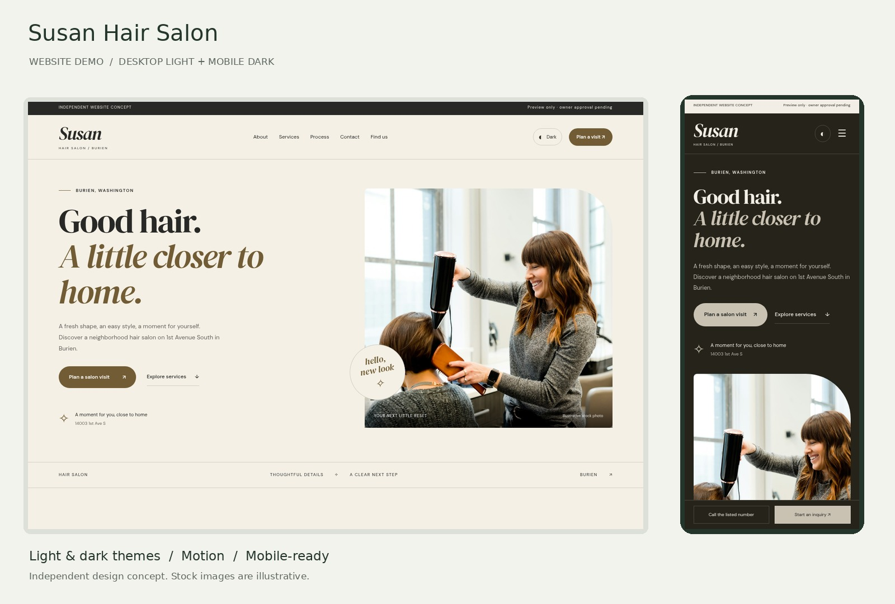

# Susan Hair Salon — website demo

[](https://local-business-demo-collection.netlify.app/susan-hair-salon/)

An independent website concept for Susan Hair Salon in Burien, Washington.

[View the current demo](https://local-business-demo-collection.netlify.app/susan-hair-salon/) · [Public source](https://github.com/deigloriamkeddy/susan-hair-salon-demo)

This repository contains only this business's project and required assets. It builds independently, with the demo at the root URL. The current hosted demo remains on the shared Netlify collection; this repository is ready to deploy as its own Netlify project.

## Features

- Responsive desktop and mobile layout, light/dark themes with saved preference.
- Hero entrance animations, scroll reveals, hover transitions, and reduced-motion support.
- About, Services, Process, Contact, and Find us navigation.
- Gallery filters/lightbox and direct telephone/directions links.
- Local-only inquiry preview with validation and downloadable summary.

## Run locally

Use Node.js 22 or later. There are no npm dependencies or framework runtime.

```sh
npm run build
npm run dev
```

Open http://localhost:4173. Rebuild after editing source. To select a different port, use `PORT=4180 npm run dev`.

## Edit and deploy

Edit `src/business.json` for content, `scripts/build.mjs` for HTML, and `public/styles.css` / `public/app.js` for styling and interactions. Photos and licensed fonts are bundled under `public/assets`.

For a new Netlify project, connect this repository: build command `npm run build`, publish directory `dist`. These settings are included in `netlify.toml`. A plain static host can also serve `dist`. No environment variables are required. `.netlify` account files and environment files are excluded from Git.

## Demo boundaries and research

This is a design concept, not an official business website. No real appointment is created and no form information is sent. The preview clears when its dialog closes. Prices, hours, availability, credentials and testimonials are not invented. Proposed service descriptions and public contact details need owner confirmation.

Photos are illustrative stock, not the business, staff, or customer results. Image source and license links are in `research/assets.json`; font licenses are bundled with the fonts. Research notes and owner checks are in `research/NOTES.md`. No private PDD text, proposal pricing, account files or credentials are included.

The demo requests no indexing using HTML metadata, robots.txt and Netlify response headers. This is a crawl directive, not password protection.
